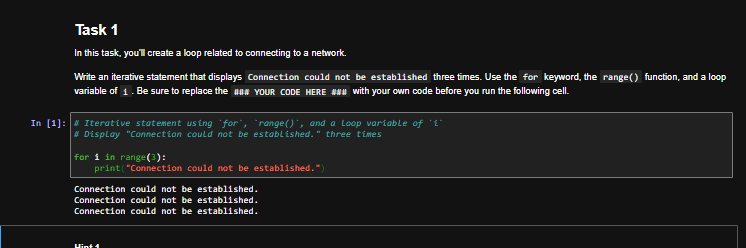
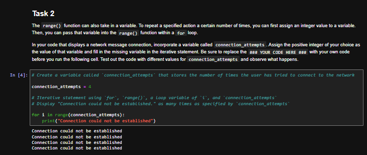
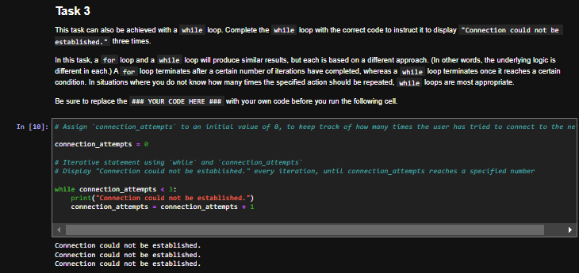
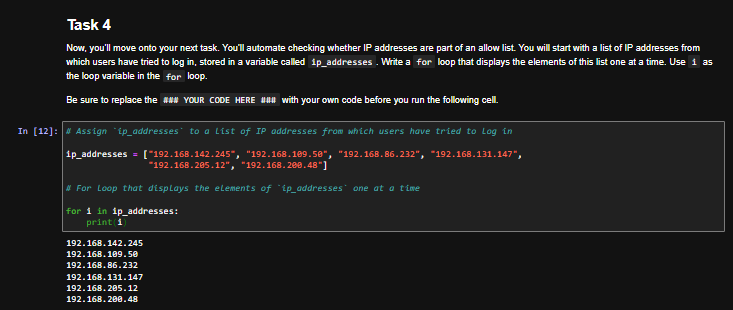
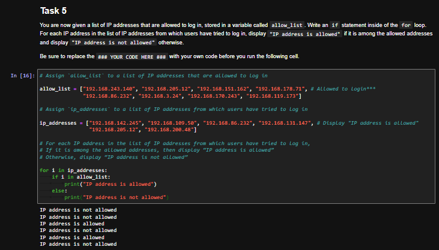
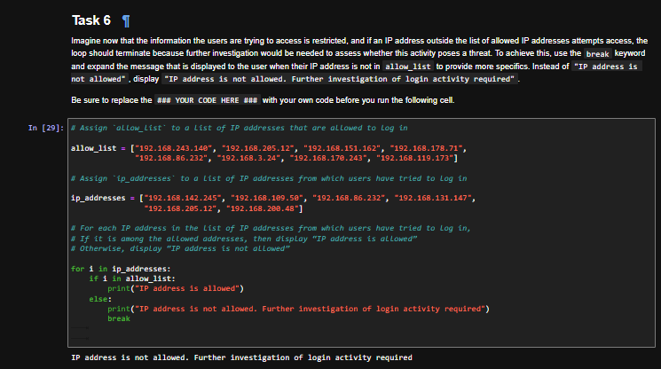
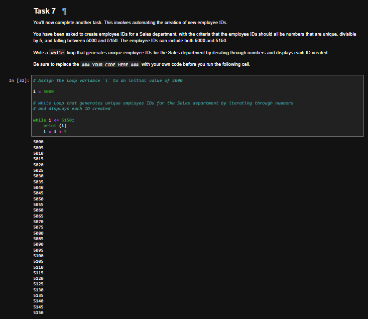
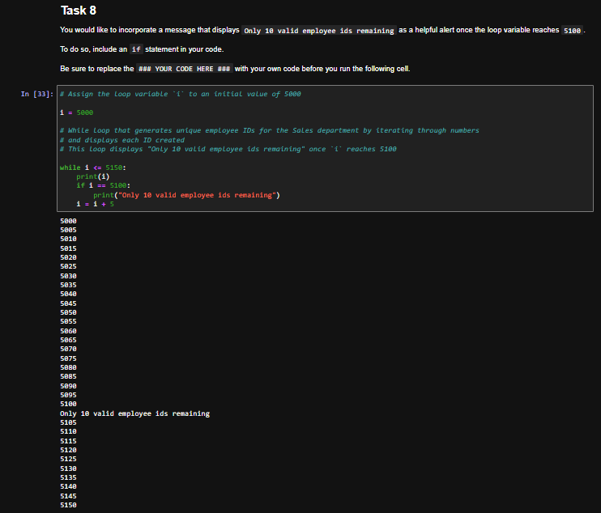

# Python Iterative Statements: IP Allow List Checks and Employee ID Generation

## Summary

In this lab from the Google Cybersecurity Certificate (Automate Cybersecurity Tasks with Python), I wrote Python `for` and `while` loops to automate repetitive security tasks: repeating a connection error message, checking a list of login IP addresses against an allow list, stopping at the first unauthorized address, and generating a range of employee IDs. The scenario, IP addresses, and IDs are fictional and provided by the course.

## Tools Used

- Python 3
- Jupyter Notebook (course lab environment)

## Skills Demonstrated

- `for` loops with `range()`
- `while` loops with a counter variable
- Iterating through a list of IP addresses
- Membership checks with the `in` operator against an allow list
- Conditionals inside a loop, and `break` to stop a loop early

## Part 1: Connection Error Messages

**Task 1: `for` loop with `range()`.** Display a connection error message three times.

```python
for i in range(3):
    print("Connection could not be established.")
```



**Task 2: variable in `range()`.** Store the number of attempts in a variable so the loop count can change without editing the loop. With `connection_attempts` set to 4, the message prints four times.

```python
connection_attempts = 4

for i in range(connection_attempts):
    print("Connection could not be established")
```



**Task 3: `while` loop.** Produce the same result with a `while` loop, starting a counter at 0 and adding 1 on each pass until it reaches 3.

```python
connection_attempts = 0

while connection_attempts < 3:
    print("Connection could not be established.")
    connection_attempts = connection_attempts + 1
```



## Part 2: Checking IP Addresses Against an Allow List

**Task 4: iterate through a list.** Print each IP address that attempted to log in.

```python
ip_addresses = ["192.168.142.245", "192.168.109.50", "192.168.86.232", "192.168.131.147", "192.168.205.12", "192.168.200.48"]

for i in ip_addresses:
    print(i)
```



**Task 5: allow list check.** Loop through the login attempts and check each one against the allow list. Only `192.168.86.232` and `192.168.205.12` are on the list, so they are the only two marked as allowed.

```python
allow_list = ["192.168.243.140", "192.168.205.12", "192.168.151.162", "192.168.178.71", "192.168.86.232", "192.168.3.24", "192.168.170.243", "192.168.119.173"]

for i in ip_addresses:
    if i in allow_list:
        print("IP address is allowed")
    else:
        print("IP address is not allowed")
```



**Task 6: stop at the first unauthorized address.** Add `break` so the loop ends as soon as an address is not on the allow list. The first address, `192.168.142.245`, is not allowed, so the script prints one warning and stops.

```python
for i in ip_addresses:
    if i in allow_list:
        print("IP address is allowed")
    else:
        print("IP address is not allowed. Further investigation of login activity required")
        break
```



## Part 3: Generating Employee IDs

**Task 7: `while` loop with a step.** Generate unique employee IDs divisible by 5, from 5000 to 5150 inclusive.

```python
i = 5000

while i <= 5150:
    print(i)
    i = i + 5
```



**Task 8: alert inside the loop.** Print an alert when the loop reaches 5100, since only 10 valid IDs (5105 through 5150) remain after it.

```python
i = 5000

while i <= 5150:
    print(i)
    if i == 5100:
        print("Only 10 valid employee ids remaining")
    i = i + 5
```



## Key Takeaways

- A `for` loop runs once for each item in a sequence, while a `while` loop keeps running as long as its condition is True, so a `while` loop needs its counter updated on every pass to avoid running forever.
- `range()` sets how many times a `for` loop repeats, and passing it a variable makes the count easy to change.
- Looping over the list of login attempts, rather than the allow list, makes sure every address gets checked, including unknown ones.
- The `in` operator is a simple way to check whether a value appears in an allow list.
- `break` stops a loop immediately, which fits a security check where one unauthorized login attempt is enough to pause and investigate.
